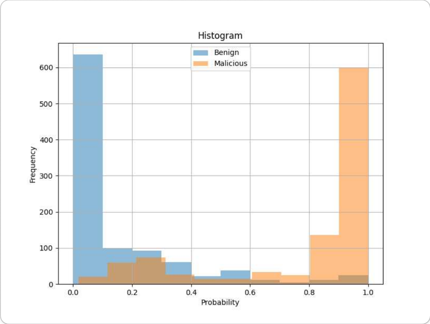

# Malicious URL & JavaScript Detection Models

Two models that decide whether a website is malicious: one reads the **URL**, the other analyzes the **JavaScript** the page loads. This repository also includes the INT8-quantized versions used in the deployed service.

> **Top Excellence Award, 2nd KISIA Information Security Developer Hackathon** (Minister of Science and ICT Award, Aug 2024)
>
> This is the AI model part of a malicious URL detection service built by a team of four during the 2024 KISIA hackathon and the KISIA AI Security Technology Development Program (network track). The full service (Chrome extension, backend, dashboard) is in [racheliee/kisia-project](https://github.com/racheliee/kisia-project).

**My role** (team lead, AI models): trained the URL and JavaScript static-analysis models, collected benign JavaScript, built the inference API, quantized the models for deployment, and helped design the detector ensemble.

## Why two models

A model that reads only the URL did poorly on URLs it had never seen. It reached F1 0.99 on data from the same source as its training set, but dropped to F1 0.68 on a URL dataset from a different source. Recall stayed at 0.99 while precision fell to 0.54, which means it flagged many benign URLs as malicious.

| Evaluation data | Precision | Recall | F1 |
| --- | --- | --- | --- |
| Same source as training ([malicious-urls-dataset](https://www.kaggle.com/datasets/sid321axn/malicious-urls-dataset), 130,239 URLs, malicious class) | 0.99 | 0.98 | 0.99 |
| Different source ([urldataset](https://www.kaggle.com/datasets/antonyj453/urldataset), from the team's final presentation) | 0.54 | 0.99 | 0.68 |

So I added a static-analysis model that looks at the JavaScript a page loads instead of the URL string. The team's service combined these two models with a dynamic-analysis detector (runtime behavior) and a network-packet detector, weighting the four results by each detector's accuracy.

## Models

### URL classifier (`url_model/`)

Reads the URL string as if it were a sentence and classifies it as benign or malicious. It is a fine-tuned DistilBERT (`distilbert-base-uncased`).

- Data: 651,191 URLs from malicious-urls-dataset, split into 520,952 for training and validation and 130,239 for testing
- Training: Colab A100, mixed precision, AdamW, lr 5e-5, early stopping
- Result (same-source test set): accuracy 0.991. The confusion matrix and learning curve are in [train/url/README.md](train/url/README.md).

### JavaScript static-analysis classifier (`static_model/`)

Judges code by its structure without running it. Obfuscation easily changes variable names and strings, but it changes the grammatical structure of the code much less.

1. Parse the code into a syntax tree (AST) with Esprima.
2. Walk the tree depth-first and list only the node types on one line.
3. Treat that line as a sentence and classify it with fastText. Scripts range from a few hundred to tens of thousands of tokens, so I chose fastText for its speed on long inputs.

An actual conversion:

```text
var s = document.createElement("script");
s.src = "http://example.com/a.js";
document.body.appendChild(s);

→ Program VariableDeclaration VariableDeclarator Identifier
  CallExpression MemberExpression Identifier Identifier Literal
  ExpressionStatement AssignmentExpression MemberExpression Identifier Identifier Literal
  ExpressionStatement CallExpression MemberExpression MemberExpression
  Identifier Identifier Identifier Identifier
```

- Data: malicious scripts from [javascript-malware-collection](https://github.com/HynekPetrak/javascript-malware-collection); benign scripts collected from Naver, Google, Facebook, Instagram, and other sites. Training: 13,622 malicious / 17,270 benign. Test: 1,000 / 1,000
- Result: precision 0.85, recall 0.91, F1 0.86



Distribution of the predicted probability of being malicious for the 2,000 test scripts. Benign scripts (blue) cluster near 0 and malicious scripts (orange) near 1, so the two groups separate well.

## Quantization for deployment (`deploy/`)

To run both models on every request in the service server, I quantized them to shrink their size. The URL model became about 4× smaller and 2.5× faster, and it gave the same verdicts as the original on every sample input.

| Model | Original → deployed | Size | Latency |
| --- | --- | --- | --- |
| URL | PyTorch FP32 → ONNX INT8 | 268 → 67 MB | 29.7 → 11.8 ms |
| JavaScript | fastText 100-dim → 50-dim + quantization | 800 → 52 MB | 4.4 → 6.4 ms |

- URL model: dynamic quantization. Weights of the linear layers are stored as 8-bit integers, and each linear layer's input is converted to 8 bits at inference time so the multiplication runs on integers.
- JavaScript model: retrained with 50-dimensional word vectors, then compressed with fastText's built-in quantization.
- Measurement: re-measured in Nov 2026 on a 2-core x86 CPU, median time per input over the 8 sample URLs and 8 sample scripts in `test_flask/`, one input at a time. JavaScript timing includes AST conversion.
- The JavaScript model only got smaller, not faster. AST conversion takes about 3.8 ms and dominates each inference, while the fastText step itself went from 0.6 to 1.7 ms after quantization. This is likely the cost of decoding the compressed vectors.
- The deployed files are identical to the ones the team's service backend used (matching SHA-256).

## Running

Python 3.10–3.11 is recommended. The fastText Python binding does not work with NumPy 2, so `numpy==1.23` is pinned. The original model weights are stored with Git LFS, so [git-lfs](https://git-lfs.com) is required.

**Original model API**

```bash
git lfs install
git clone https://github.com/seungwooLee00/malicious-url-detection
cd malicious-url-detection
pip install -r requirements.txt
python -m test_flask.app            # http://127.0.0.1:5000

bash test_flask/requestURL.sh       # in another terminal: classify 8 sample URLs
bash test_flask/requestJS.sh        # classify 8 sample scripts
```

**Quantized model API**

```bash
cd deploy
bash download_models.sh             # download the deployed models from a pinned commit of the team repo and verify hashes
pip install -r requirements.txt
python app.py                       # http://127.0.0.1:5000, same endpoints as the original
```

There are two endpoints, `POST /predictURL` and `POST /predictJS`. Each takes multiple files in the `files[]` field and returns one result per file.

```json
[{"prediction": "benign", "confidence": 0.9753}, {"prediction": "malicious", "confidence": 0.9998}]
```

## Layout

```text
url_model/      URL classifier (DistilBERT, weights in Git LFS)
static_model/   JavaScript static-analysis classifier (fastText, weights in Git LFS)
train/          training code and notebooks (url/, static/)
test_flask/     inference API for the original models and sample request scripts
test/           offline inference timing scripts (data not included)
deploy/         inference API for the quantized deployment models
```

## Limitations

- The URL model overfits to the URL format of its training data. Re-running the sample URLs shows that its verdict depends on whether the URL starts with `https://`. That is why the service never used it alone, only together with the other detectors.
